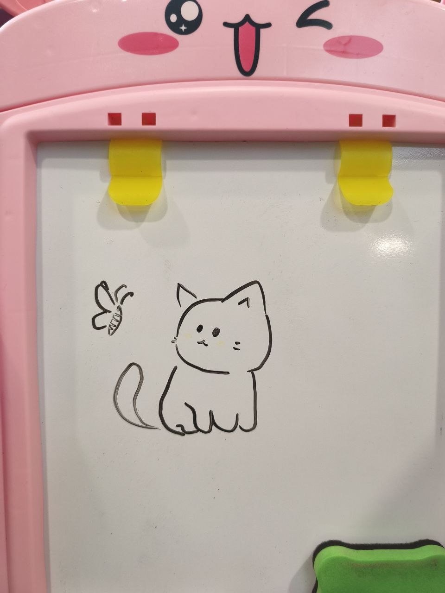

# Hi there, I'm Abdul Hafiz 👋

 
 
 

  

 
 
 

## Introduction

###  I'm 22-year-old Software Engineering student at University Malaya.

###  Learning:
- ✨ Software Maintenance & Evolution
- ✨ Automation & bots
- ✨ Building a B2B SaaS product

###  Hobbies: 
- ✨ Gaming (probably too much)
- ✨ Listening to music
- ✨ Speed typing
- ✨ Bouldering

 
 

👉 *The cat on the right is something I drew recently!*

 
 

## 📚 Currently Taking: Software Maintenance & Evolution

Most software isn't built from scratch. It's maintained, fixed, and improved for years.
That's what this course is all about, and here's what I'm hoping to get out of it:

- Learn how to work with legacy code without breaking everything
- Pick up good practices for evolving software as requirements change
- Apply what I learn to my own B2B SaaS, so it's easier to maintain as it grows

<!--🦶FOOTER-->

